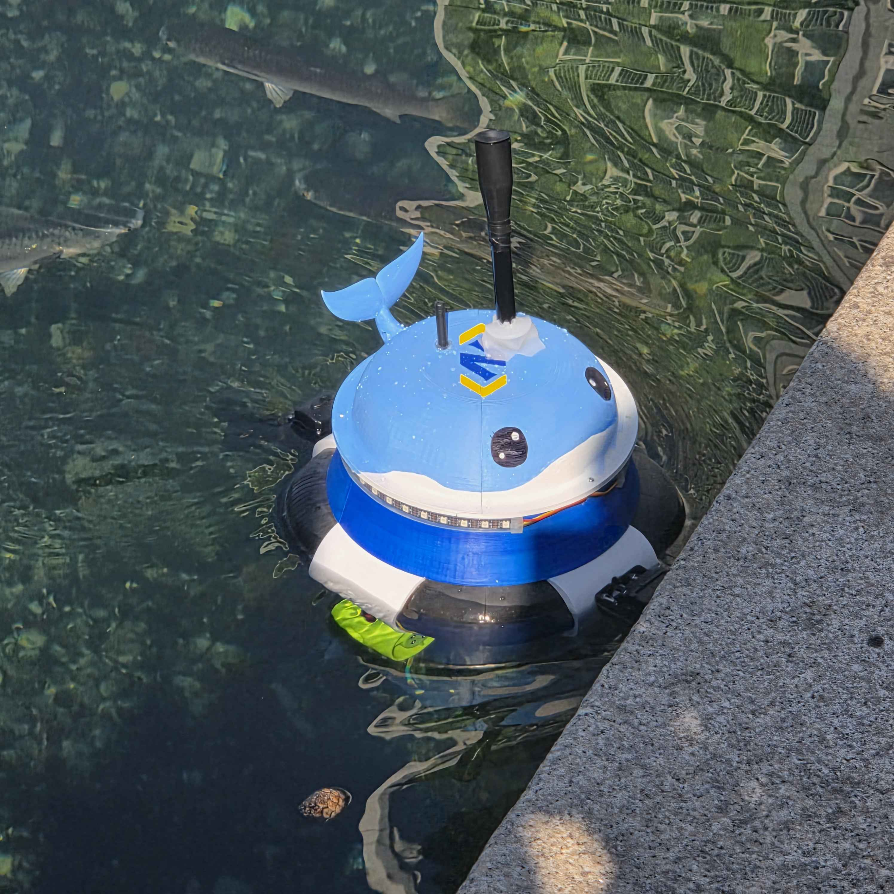
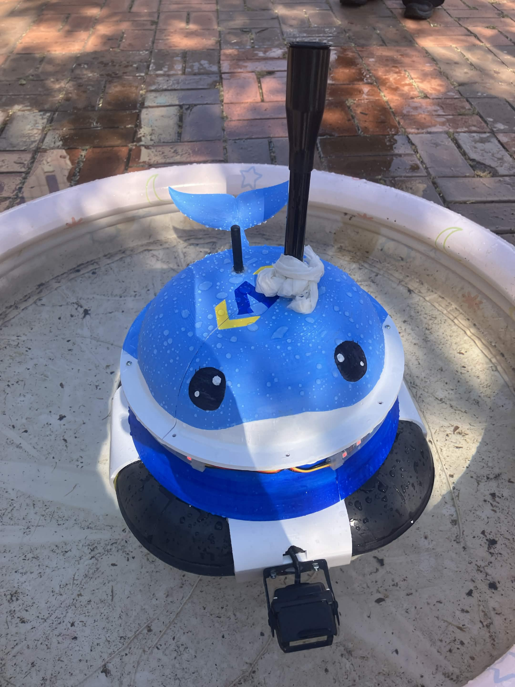
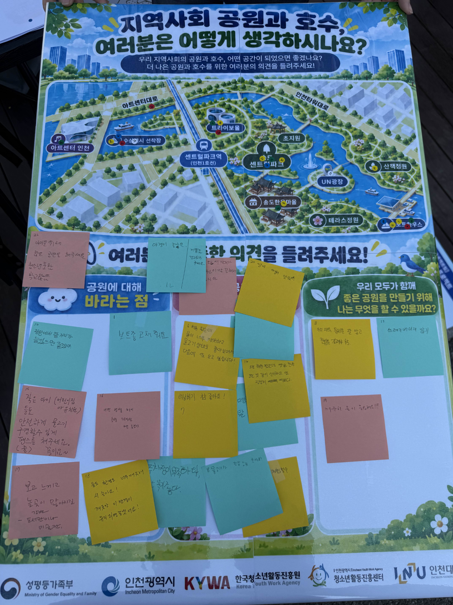
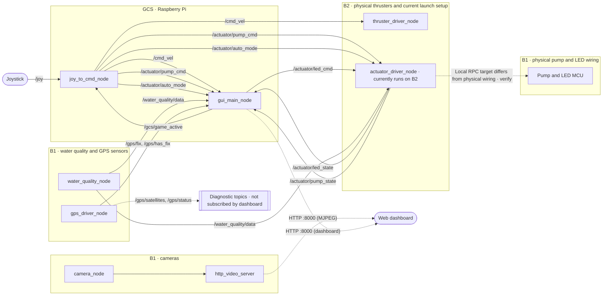
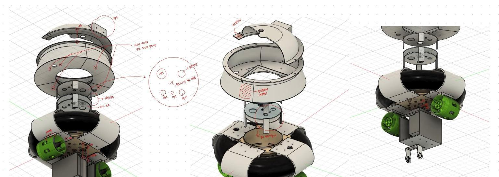
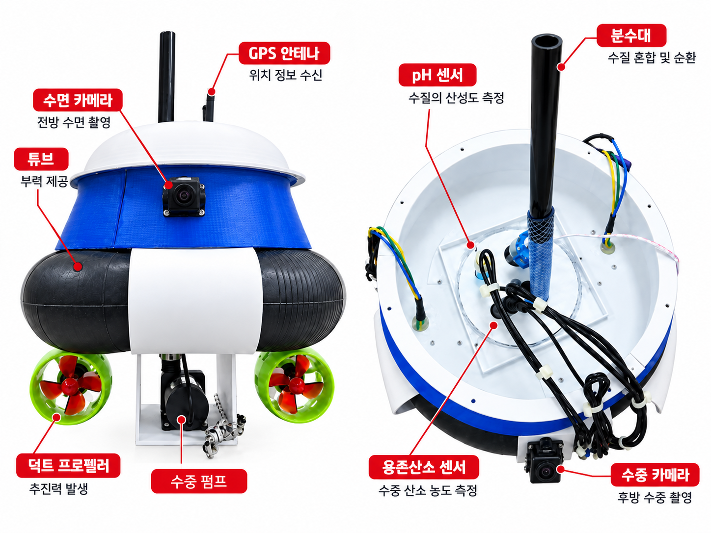
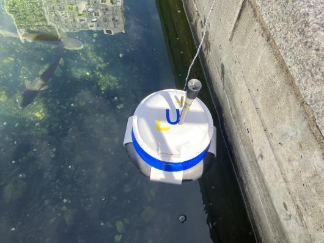

[한국어](README.md) | [English](README_EN.md)

# 🌊 6can
### by Team Eco Bridge AI

> **"A small eye watching over our neighborhood lake"**
> An AI-based unmanned surface vehicle (USV) project for monitoring local water quality and responding to changes.

6can is a project-based learning (PBL) community service project by **Team Eco Bridge AI** addressing water quality in Incheon. The USV is designed to travel on the water, measure turbidity, pH, dissolved oxygen, and water temperature, and control a purification pump based on the readings. Water quality and location data are shown on a web dashboard.

## 📷 Activity Photos and Demonstration Video

These show the boat on the water at Incheon Central Park, a boat image, and photos from the team's community feedback activity. Select a photo to open the original file.

| USV on the water at Incheon Central Park | 6can boat image | Community feedback board about the park and lake |
|---|---|---|
| [](media/usv-on-water.png) | [](media/usv-boat.png) | [](media/community-feedback-board.png) |

**Demonstration video:** [Watch the USV spray water at Incheon Central Park (MP4)](media/usv-water-spray-demo.mp4)

---

## 📌 Background and Problem

The project began with concerns about algal growth and floating debris in the lake at Songdo Central Park. The team proposed a boat that could move across the water, report water quality and position, and activate a fountain pump when needed.

| Limitation of existing monitoring | Description |
|---|---|
| **Infrequent measurements** | Manual sampling may miss changes between site visits. |
| **Recurring operating costs** | Each inspection requires staff time and travel. |
| **Hard-to-reach areas** | Areas that require a boat may be inspected less often. |
| **Limited public visibility** | Water quality data may not be available or easy for residents to understand. |

6can aims to make measurements available more often and present them in a form that residents can follow.

---

## 🎯 Project Goals

- 🌐 **Water quality monitoring** — Measure turbidity, pH, dissolved oxygen, and water temperature from the USV.
- 🤖 **Automated response** — Develop pump control based on water quality classification.
- 🕹️ **Remote steering** — Allow an operator to drive the USV with a joystick.
- 📊 **Accessible display** — Show water quality and a GPS mini-map on the web dashboard.
- 💸 **Accessible hardware and software** — Use Arduino UNO Q boards and ROS 2 as a basis for replication and extension.

---

## ⚠️ Operating Behavior

- 🚤 **Boat movement** — Joystick steering works independently of the dashboard game state.
- 🔒 **Pump, automatic/manual mode, and LED** — Controls are accepted only while the dashboard game is active after START is pressed.
- 🔄 **Reset** — Starting or ending the game resets control to manual mode and turns the LED off.

---

## 🛠 System Architecture and Roles

The system has **two hardware control boards** on the USV and **one shore-based monitoring and control computer**. The boards exchange ROS 2 messages over DDS. Operators use a web browser for the dashboard.

| Part | Board | Role | Main technologies |
|---|---|---|---|
| 🔧 **Sensing, video, and purification hardware** | B1 (Arduino UNO Q) | Connected to the water quality and GPS sensors, surface and underwater cameras, pump, and LED | ROS 2 Jazzy in Docker, MCU RPC, OpenCV (V4L2), MJPEG |
| 🔧 **Propulsion hardware** | B2 (Arduino UNO Q) | Separate board connected only to the thrusters | ROS 2 Jazzy in Docker, PWM motor driver, MCU RPC |
| 💻 **Ground control station (GCS)** | Raspberry Pi | Converts joystick input into commands and serves ROS state through a web API and dashboard | ROS 2, Python (Flask), HTML5 Canvas, HTTP polling |

**Communication:** B1, B2, and the GCS exchange ROS 2 topics. The browser polls the GCS Flask endpoint `/api/state` every 200 ms. The boat shown in the dashboard moves according to `/cmd_vel`; GPS is used only for the mini-map. B1 serves the MJPEG camera streams directly to the browser, without routing them through the GCS.

**Current deployment mismatch:** The pump and LED are physically connected to B1, but `actuators.launch.py` currently starts `actuator_driver_node` on B2. That node uses local MCU RPC, so pump and LED control with the present wiring needs verification. This documentation update does not change the board code or startup scripts.

### 📡 System Diagram



### 🔩 Design and Physical Hardware



*USV 3D design*



---

## 🧪 Build and Test Record

| Stage | Recorded in the presentation |
|---|---|
| Component selection | The team reviewed operating conditions and component compatibility with faculty advice. |
| Sensor checks | Measurements were compared with reference solutions and expected values. |
| System integration | The team checked compatibility issues after combining each part. |
| Mobility and field tests | Mobility was tested at Incheon National University, followed by a field test at Songdo Central Park. |



*Songdo Central Park field test*

---

## 💡 Expected Benefits

| Benefit | Intended effect |
|---|---|
| 🌱 **Water quality management** | More frequent observations could help identify changes sooner and support a response. |
| 💰 **Lower inspection effort** | Some repeated site visits could be supplemented by remote measurements. |
| 📣 **Public awareness** | A readable dashboard could make local water quality information easier to access. |

---

# 🔧 Technical Guide

> Configuration and operation details for building, running, and tuning this repository.

## ⚙️ Parameters to Check First

Adjust these values for the hardware and site before changing the program logic.

| Parameter | Location | Default | Change when |
|---|---|---|---|
| `camera_host` | `src/usv_gcs/config/gcs_params.yaml` or `gcs.launch.py` argument | `192.168.0.6` (example in the config file) | Set it to the actual B1 IP address. |
| `linear_axis` / `angular_axis` / `angular_scale` | `gcs.launch.py` arguments | `1` / `0` / `-1.0` | The joystick axes or directions differ. |
| `pump_button` / `auto_button` | `gcs.launch.py` arguments | `0` (A) / `1` (B) | The joystick button mapping differs. |
| `linear_ramp_rate` / `angular_ramp_rate` | Defaults declared in `src/usv_gcs/usv_gcs/joy_to_cmd_node.py`; not launch arguments | `0.2` / `0.4` | Steering or acceleration should respond more gradually or quickly. |
| `GACHA_GAMEPAD_BUTTON_INDEX` | Constant in `dashboard_html.py` | `2` (Y, unverified) | After checking the button index on the actual controller. |
| `max_pwm` | `actuators.launch.py` argument | `255` | The motor driver requires a different PWM limit. |
| `bad_below` / `good_above` / `*_manual_hold_s` | `actuators.launch.py` arguments | `40.0` / `60.0` / `60.0` seconds | Water quality thresholds or manual override duration need adjustment. |
| `BACK_GAMEPAD_BUTTON_INDEX` | Constant in `dashboard_html.py` | `8` (unverified) | After checking the button index on the actual controller. |
| `SHOW_SURFACE_CAM` / `SHOW_UNDERWATER_CAM` | Constants near the top of `dashboard_html.py` | `true` / `true` | Either camera panel should be hidden. |
| `surface_device` / `underwater_device` | `camera_streaming.launch.py` arguments | `/dev/video2` / `/dev/video3` | USB camera device numbers change; check with `v4l2-ctl --list-devices`. |

After changing a constant in `dashboard_html.py`, restart `gui_main_node` to serve the new HTML and JavaScript. The process keeps the page in memory, so `--symlink-install` does not provide hot reload.

---

## 🚀 Running the System

```bash
# 1. B1: sensors and cameras; pump and LED are wired to B1
./start_b1.sh

# 2. B2: thrusters; the current launch also starts the actuator control node
cd src/usv_actuators && ./start_actuators.sh

# 3. GCS: connect the joystick first
sudo apt install ros-jazzy-joy
colcon build --symlink-install --packages-select usv_gcs
source install/setup.bash
ros2 launch usv_gcs gcs.launch.py
```

Open `http://<GCS_IP>:8000` in a browser, or `http://localhost:8000` on the GCS.

The `install_*_autostart.sh` scripts can configure B1 and B2 to start when powered on. See `start_*.sh` and `systemd/*.service` under each package for board-specific build, container, and service details.

---

## 🕹️ Joystick Controls

One controller handles both **physical boat steering through ROS** and **dashboard interactions through the browser**. Forward, reverse, and turning commands work regardless of the dashboard game state. Pump, automatic/manual mode, and LED commands are accepted only while the game is active. Starting or ending the game returns to manual mode and turns the LED off.

| Area | Input | Action |
|---|---|---|
| Boat steering (ROS `/joy`) | Left stick, horizontal / vertical | Turn / move forward or backward through `/cmd_vel`, regardless of game state. |
| Boat steering (ROS `/joy`) | A button | Toggle the pump in manual mode while the game is active. |
| Boat steering (ROS `/joy`) | B button | Toggle automatic/manual control while the game is active. |
| Dashboard (browser Gamepad API) | Start button | Start the dashboard game. |
| Dashboard (browser Gamepad API) | X button | Toggle the LED while the game is active. |
| Dashboard (browser Gamepad API) | Y button | Use the in-game draw interaction. |
| Dashboard (browser Gamepad API) | Back button | Return to the opening screen. |

To identify button indices on the actual controller, run this in the browser console (F12):

```js
setInterval(() => console.log(navigator.getGamepads()[0]?.buttons.map((b,i)=>b.pressed?i:null).filter(v=>v!==null)), 300)
```

---

## 📎 References

- Topic names and types, board-specific build options, Docker settings, and systemd settings are documented in the launch files and scripts under `src/usv_sensors`, `src/usv_actuators`, `src/camera_streaming`, and `src/usv_gcs`.
- The current `usv_actuators` package starts both the thruster node and the pump/LED control node on B2. The physical wiring places the pump and LED on B1 and only the thrusters on B2.
